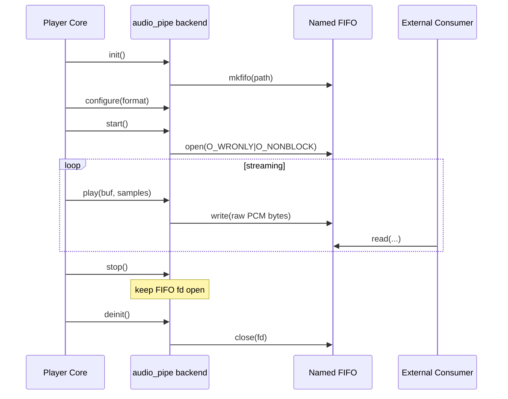

# Pipe Audio Backend Flow

## File

- Source file: [audio_pipe.c](../audio_pipe.c)
- Backend object: [audio_pipe](../audio_pipe.c#L178)

## Purpose

This backend writes decoded PCM frames to a named FIFO (pipe) instead of a hardware or software audio server.

It is useful for:

- Forwarding Shairport Sync audio into external processes.
- Debugging or integrating with custom audio pipelines.
- Simple file/stream-style consumers that can read a FIFO.

## Main Control Surface

Callbacks exported by [audio_pipe](../audio_pipe.c#L178):

- help: [help](../audio_pipe.c#L154)
- init: [init](../audio_pipe.c#L101)
- deinit: [deinit](../audio_pipe.c#L152)
- get_configuration: [get_configuration](../audio_pipe.c#L158)
- configure: [configure](../audio_pipe.c#L165)
- start: [start](../audio_pipe.c#L51)
- play: [play](../audio_pipe.c#L73)
- stop: [stop](../audio_pipe.c#L97)

Not implemented in this backend:

- is_running, flush, delay, stats, volume, parameters, mute.

## Runtime Model

1. Pipe endpoint state
- FIFO path in [pipename](../audio_pipe.c#L48), defaulting to [default_pipe_name](../audio_pipe.c#L49).
- Writer file descriptor in [fd](../audio_pipe.c#L44).

2. Frame size state
- [bytes_per_frame](../audio_pipe.c#L46) is set in [configure](../audio_pipe.c#L165).
- play() uses this to compute write size from sample count.

## Initialization Flow

[init](../audio_pipe.c#L101):

1. Sets backend defaults for buffer length and latency offset.
2. Parses backend audio options with fixed defaults:
- AirPlay 2 build: 48kHz, S32_LE, 2ch.
- Non-AirPlay 2 build: 44.1kHz, S16_LE, 2ch.
3. Resolves pipe name from config (`pipe.name`) and/or command-line argument.
4. Rejects special value `STDOUT` for this backend.
5. Falls back to `/tmp/shairport-sync-audio` if none supplied.
6. Creates FIFO with mkfifo (ignores EEXIST).

## Format, Rate, and Channel Capabilities

The pipe backend is not fixed to 16-bit / 44.1 kHz.

Current behavior:

1. Defaults are build-mode dependent:
- AirPlay 2 builds default to `S32_LE`, `48000`, `2` channels.
- Classic (non-AirPlay-2) builds default to `S16_LE`, `44100`, `2` channels.

2. Capabilities are configurable through the shared audio option parser:
- `pipe.output_rate`
- `pipe.output_format`
- `pipe.output_channels`

3. The backend selects output via shared configuration search and then writes raw PCM bytes to the
FIFO for the selected format.

Practical note:

- If a downstream consumer (for example, Snapserver) expects a fixed PCM format, pin pipe output to
single values for rate/format/channels so both sides match exactly.

### Snapserver 24/48 Interop Status

Current status (as observed in practice and consistent with packing code):

- `S24_3LE` from Shairport Sync is packed 24-bit PCM (`3` bytes/sample), so it does not match
  Snapserver `sampleformat=...:24:...` (`4` bytes/sample).
- `S24_LE` from Shairport Sync is 24-in-32 with an explicit zero padding byte, not sign-extension
  of the 24-bit sign bit.
- With Snapserver configured for `sampleformat=...:24:...`, both combinations can sound distorted.

Verification references:
- Shairport Sync sample sizes: [sps_format_sample_size_array](../common.c#L135)
- Shairport Sync byte packing: [process_sample](../player.c#L2010)
- Snapserver `bits=24` sample size handling: <https://github.com/snapcast/snapcast/blob/develop/common/sample_format.cpp>

### Recommended Stable Setup (Shairport Sync + Snapserver)

Until 24-bit container expectations are aligned end-to-end, use fixed 32-bit / 48 kHz stereo on both sides.

Shairport Sync (`shairport-sync.conf`):

- `general.output_backend = "pipe"`
- `pipe.name = "/tmp/snapfifo-airplay"`
- `pipe.output_rate = 48000`
- `pipe.output_format = "S32_LE"`
- `pipe.output_channels = 2`

Snapserver (`/etc/snapserver.conf`):

- `source = pipe:///tmp/snapfifo-airplay?name=AirPlay&mode=read&sampleformat=48000:32:2&codec=flac`

Notes:

- Keep the values fixed (do not use `auto` or multi-value lists) for FIFO consumers that assume a
single stream format.
- If 32-bit is not acceptable in your environment, test 16-bit explicitly:
`sampleformat=48000:16:2` with `pipe.output_format = "S16_LE"`.

### 32/48 Sine-Wave Test Fixture (recommended)

Use this fixture to verify a fixed 32-bit / 48 kHz FIFO path.

Validate the consumer chain (Snapserver and clients) with a known-good 32/48 source:

```bash
# terminal A
sudo -u shairport-sync ffmpeg -re -f lavfi -i "sine=frequency=1000:sample_rate=48000:duration=15" -ac 2 -c:a pcm_s32le -f s32le /tmp/snapfifo-airplay
```

If this is clean at clients, the Snapserver side can decode/play 32/48 correctly.

Step 2: Validate Shairport Sync FIFO output format directly.

- Keep Shairport Sync pinned to fixed 32/48/2 settings.
- Ensure only one FIFO reader is active while capturing raw bytes.

Capture five seconds from the FIFO:

```bash
timeout 6s head -c 1920000 /tmp/shairport_pipe_5s.raw < /tmp/snapfifo-airplay
```

Expected byte count for 5 seconds at 32/48 stereo:

- `48000 * 2 * 4 * 5 = 1920000` bytes

Decode check:

```bash
ffmpeg -f s32le -ar 48000 -ac 2 -i /tmp/shairport_pipe_5s.raw -f null -
```

Interpretation:

- Clean decode and expected byte count indicate correct 32/48/2 pipe output.
- Size mismatch indicates a format/rate/channel mismatch in configuration.
- For current Snapserver interop, prefer 32/48 over 24/48.

## Configuration Flow

[get_configuration](../audio_pipe.c#L158):

- Uses generic `search_for_suitable_configuration(...)` without backend-specific checks.

[configure](../audio_pipe.c#L165):

1. Derives bytes per sample from encoded output format.
2. Computes `bytes_per_frame = bytes_per_sample * channels`.
3. Returns EINVAL only if format size is unknown (with fallback size used internally).

## Start and Write Flow

[start](../audio_pipe.c#L51):

- Attempts non-blocking open of FIFO for writing.
- Treats ENXIO as non-fatal (no reader attached yet).
- Logs warning only for other open errors.

[play](../audio_pipe.c#L73):

1. If FIFO is not open, retries opening it.
2. If open, computes bytes to write from sample count and `bytes_per_frame`.
3. Writes raw PCM bytes directly to FIFO.
4. Suppresses repeated warning spam by logging non-EPIPE write errors once.

Behavior with no reader:

- Open may keep failing with ENXIO until a consumer opens the FIFO.
- play() keeps returning success while retrying open/write opportunistically.

## Stop and Shutdown

[stop](../audio_pipe.c#L97):

- Intentionally does not close FIFO between play sessions.

[deinit](../audio_pipe.c#L152):

- Closes writer file descriptor safely.

## Error Handling Notes

- ENXIO on open is expected when no reader is attached.
- EPIPE on write is treated as expected disconnect behavior.
- Other write/open errors are logged.

## Short Sequence Diagram



## Practical Reading Order

1. [audio_pipe](../audio_pipe.c#L178)
2. [init](../audio_pipe.c#L101)
3. [get_configuration](../audio_pipe.c#L158)
4. [configure](../audio_pipe.c#L165)
5. [start](../audio_pipe.c#L51)
6. [play](../audio_pipe.c#L73)
7. [stop](../audio_pipe.c#L97)
8. [deinit](../audio_pipe.c#L152)
